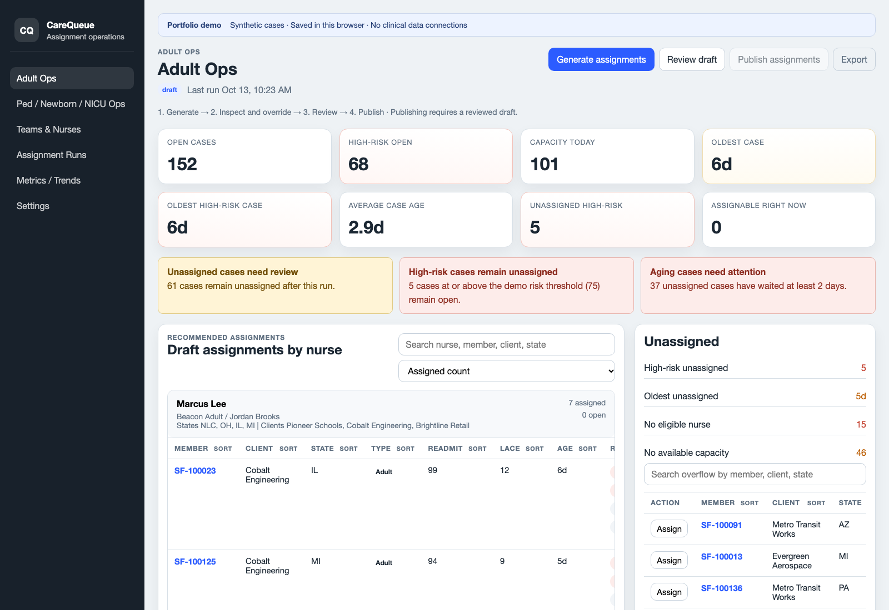

# CareQueue

**A care-management assignment workflow with explainable routing, human review, and an auditable publish step.**

CareQueue turns a synthetic morning case queue into nurse assignments while respecting client coverage, case-type capabilities, state eligibility, and remaining capacity. It makes blocked and aging cases visible so a reviewer can understand both the recommendations and the work left over.

[](https://github.com/mylesbrandon/CareQueue/actions/workflows/ci.yml)

Built with **Next.js, React, JavaScript, and TanStack Table**. The assignment engine is independent of React, with **104 named synthetic scenarios** covering eligibility, capacity, prioritization, overrides, publishing, and alerts. **7 Playwright browser scenarios** exercise the operator workflow in Chromium.



## What you can try

- **Generate a draft:** prioritize open cases, apply nurse eligibility rules, and inspect the explanation for each assignment.
- **Resolve exceptions:** see client, capability, state, and capacity blockers alongside a case-age watchlist.
- **Make a manual override:** choose an eligible nurse or remove a recommendation, record a reason, and review the updated plan.
- **Review and publish:** require review before publication, lock the published run, and export the assignment list as CSV.
- **Follow the result:** retain rosters and published run history in this browser and inspect metrics derived from published runs.

The demo includes **200 adult cases, 60 specialty cases, and 28 nurses**. The synthetic roster and case attributes use fixed seeds; case dates are relative to the demo's reference date.

## Run locally

Use Node.js 22 or newer and npm.

```bash
npm ci
npm run dev
```

Open [localhost:3000](http://localhost:3000). No credentials, database, or environment variables are required.

```bash
npm test          # Assignment and workflow scenarios
npm run build    # Production compilation and route generation
npm start        # Serve the production build
npx playwright install chromium
npm run test:e2e  # Browser workflow checks (requires the build)
```

Start with the [three-minute demo](docs/demo.md), then inspect the [rule specification](docs/rules.md), [architecture](docs/architecture.md), and [validation strategy](docs/testing.md).

## Engineering decisions

| Decision | Why it matters |
| --- | --- |
| One domain layer for generation, overrides, and publishing | UI actions must preserve the same eligibility and capacity rules. |
| Explicit draft → reviewed → published lifecycle | Publishing cannot silently skip review or leave a published run editable. |
| Rebuild derived views after a change | Assignments, capacity, overflow, aging alerts, and summary counts stay consistent. |
| Reasons and timestamps on overrides | A reviewer can trace why the recommendation changed. |
| Small fixtures plus seeded workflow scenarios | Tests exercise boundary conditions and complete workflows with reproducible inputs. |

## Routes

| Route | Purpose |
| --- | --- |
| `/` | Adult assignment workspace |
| `/specialty` | Pediatric, newborn, and NICU workspace |
| `/teams` | Edit nurse eligibility inputs and capacity |
| `/runs` | Published assignment runs and override history |
| `/metrics` | Summaries of locally published runs |
| `/settings` | Enforced demo rules and local demo reset |

## Scope

This is a **portfolio demonstration using synthetic data**, not a deployed clinical system. Publishing saves a browser-local snapshot; it does not send assignments to nurses or an external service. Browser storage is editable and can be cleared, so the history is a demo audit trail, not a secure or shared record.

There is no authentication, server-side authorization, database, EHR integration, or notification service. Risk scores and the compact-license lookup are illustrative inputs, not validated clinical predictions or current licensing advice. Do not enter real patient information.

Before real operational use, the next milestones would be authenticated roles, transactional server-side validation, durable audit storage, authoritative eligibility data, and a workflow validated with clinical operations staff.
