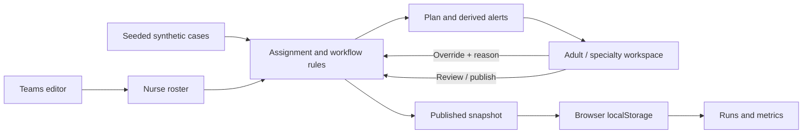

# Architecture

CareQueue separates assignment policy from presentation. Domain functions produce a plan; React renders it and submits user actions back to the domain layer.

## Boundaries

| Area | Responsibility |
| --- | --- |
| `lib/carequeue-data.js` | Synthetic fixtures, input validation, eligibility, prioritization, assignment plans, derived metrics and alerts. |
| `lib/carequeue-workflow.js` | Pure lifecycle transitions, override audit events, reviewed revisions, and published snapshots. |
| `components/demo-provider.js` | Shared browser session, versioned local storage, roster updates, and history. |
| `components/ops-workspace.js` | Render plan groups and exceptions, collect overrides, and expose review/publish/export actions. |
| `components/data-table.js` | Shared sortable table rendering with TanStack Table. |
| `app/teams/page.js` | Edit inputs used by the assignment engine. |
| `app/runs/page.js`, `app/metrics/page.js` | Display published history and summaries. |
| `app/settings/page.js` | Explain enforced rules and reset the local demonstration. |

Cases and nurses use stable identifiers. An assignment joins a case ID to a nurse ID; display names do not act as keys. A plan includes assignment groups, overflow, aging rows, and summary metrics. These views must be rebuilt together after an override so they cannot disagree about the same case.

## Assignment strategy

The engine sorts open cases by explicit priority, then assigns each case to the eligible nurse selected by deterministic capacity tie-breaks. An unassignable case remains in overflow with a reason.

This is a greedy policy chosen for traceability and a small demo workload. It is not a global matching optimizer: assigning a flexible nurse early can leave a later, more constrained case without a match. A future optimizer would need a defined objective and comparative tests before replacing this behavior.

## State and publication

A run progresses through `draft → reviewed → published`. `createWorkflow`, `applyOverride`, `reviewWorkflow`, `publishWorkflow`, and `startNextRun` implement the transitions without mutating their inputs. Manual changes need a reason and invalidate the current review. Publishing rechecks eligibility, capacity, and the reviewed revision, and rejects changed inputs before capturing its result. A published run is locked; a new run respects the previous publication's case and workload commitments.

Roster edits and run state are stored in the current browser. Updating a roster disables editing and publication until the operator generates a new draft using current inputs; previously published snapshots retain their historical inputs. The Teams, Runs, and Metrics pages share this state.

The browser is the persistence boundary. The provider uses the `carequeue-demo-v1` localStorage key and listens for changes from other tabs. This synchronizes views but does not make competing writes transactional. There is no API route that dispatches assignments, no shared database, and no cross-user concurrency control. A production publish operation would need a server transaction covering roster version, capacity reservations, assignments, and audit events.

## Tradeoffs to discuss in an interview

- **Explainability:** explicit filters and tie-breaks make decisions easy to inspect, but do not prove optimal coverage.
- **Consistency:** rebuilding plan views costs more work than patching a single row, but prevents stale metrics and alerts.
- **Human control:** overrides may change a recommendation while preserving hard eligibility and capacity constraints.
- **Demo portability:** browser persistence makes the project easy to run without credentials, while deliberately limiting durability and collaboration.
