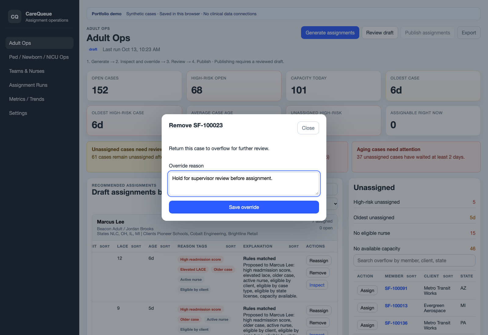

# Three-minute demo

Start the app with `npm ci && npm run dev`. Use a fresh browser session or the Settings reset action for a repeatable starting point. All people, organizations, and cases are synthetic.

## 0:00–0:40 — Generate and explain

1. Open **Adult Ops** and generate assignments.
2. Expand a nurse group and open a case's member link.
3. Point out the score, case age, eligibility reasons, and nurse capacity.

Say: “The engine ranks open cases, applies client, capability, state, and capacity rules, and explains each recommendation.”

## 0:40–1:10 — Show the work left over

1. Inspect **Unassigned** and its blocker reasons.
2. Open the **Case-age Watchlist** and identify an aging case.
3. Switch briefly to **Ped / Newborn / NICU Ops** to show the separate capabilities and subtype counts.

Say: “Overflow stays visible with a reason. These are in-app alerts; the demo does not send clinical notifications.”

## 1:10–2:10 — Override, review, publish

1. Return to Adult Ops. Select **Reassign** for a case with another eligible nurse.
2. Select a nurse and enter a reason such as “Balance the demo team's remaining workload.” If no alternative is available, cancel and use **Remove** with “Hold for supervisor review.”
3. Confirm the override appears in the activity log and the updated plan needs review.
4. Choose **Review draft**, then **Publish assignments**.
5. Show that published assignments are locked and export the CSV.

Say: “A manual decision still has to meet the hard constraints. Changing the plan invalidates review, and publication revalidates and locks a snapshot.”

## 2:10–3:00 — Demonstrate persistence and evidence

1. Open **Assignment Runs** and find the run just published.
2. Open **Metrics / Trends** to show summaries derived from local published runs.
3. Reload the page and show that history remains.
4. Show a terminal running `npm test`, then open the [test strategy](testing.md) and [architecture](architecture.md).

Say: “The core rules and lifecycle are verified with reproducible synthetic scenarios. Persistence is local to this browser. Production use would require an authenticated backend, durable audit history, verified eligibility data, and operational validation.”

## Useful follow-up demonstrations

- In **Teams & Nurses**, deactivate a nurse or reduce capacity, then generate a new unfinished plan and show the changed eligibility.
- Attempt to publish before review and explain the lifecycle guard.
- Explain why a greedy assignment policy can be auditable without being globally optimal.
- Explain the difference between synthetic test coverage and evidence of clinical effectiveness.
